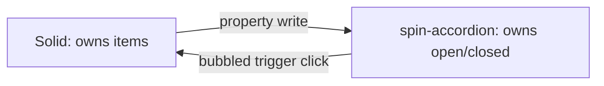

# specimens

A browser harness for the spin custom elements. Each component gets one route;
the route renders it under a **Solid controller** and nothing else.

Run it:

```sh
cd packages/components/specimens
deno task dev        # vite dev server
deno task build      # static build
deno task typecheck  # tsc --noEmit
```

## Why here

The harness lives beside the components it exercises, not in `apps/`. The
studio is a theme editor and the reference app documents the preset; neither
mounts a spin element. `demo/` was the throwaway this replaces — a vite build
input and a hand-typed `.html` per component. This app has one shell and a
router, and it reuses the same plugin stack (`spinElements` + the spin UnoCSS
preset) so a specimen renders exactly what a consumer would get.

## Routes

`src/specimens.ts` is the single table: id, title, path, component. `app.tsx`
turns it into routes and `routes/index.tsx` into links, so a URL is written
once. Add a component by adding one entry.

## The controller shape (L4)

The element is a leaf. Solid is the controller around it:



- **Solid owns the data.** `routes/accordion.tsx` holds the item array in a
  signal. Appending an item pushes a new array down and the element re-renders.
- **Props go down as properties.** `components/SpinAccordion.tsx` writes
  `el.items = props.items` from an effect. Objects are not stringified into
  attributes.
- **Events come up as DOM events.** The element does not invent an event
  channel; its trigger clicks bubble out of the custom element. The wrapper
  maps the clicked trigger back to the item it owns and calls `onToggle`, which
  the route renders.

## How props reach the element

`define` gives every declared `<scope>` prop a live signal on the element: a
property write and a parsed attribute land in the same store, and the component
reads it live. The element plugin seeds the generated `build()` from that
store:

- **Property write wins.** If a declared prop has been written (before or after
  connection), that value is read; a later write updates the component in place.
- **Attribute is the initial path.** With no property write, the value is the
  parsed attribute, or the declared default.

So `<spin-accordion items={[...]}/>` in Solid works as a property, and the
static `<spin-accordion items='[...]'>` form still works as markup.
